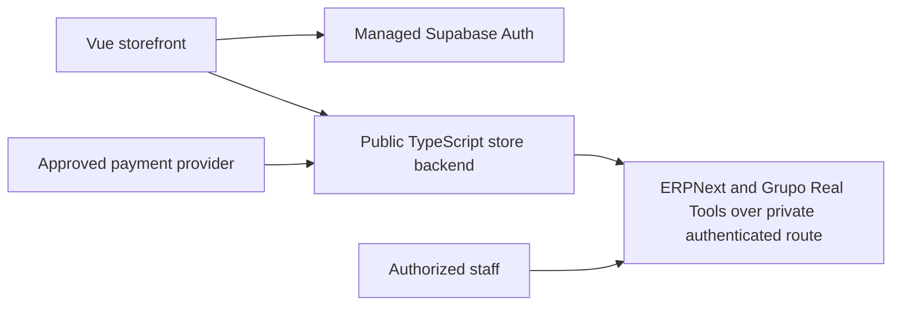

# Store architecture

## Current local behavior

| Browser dependency                                                                                                                       | Observed source                                                                                                                                            |
| ---------------------------------------------------------------------------------------------------------------------------------------- | ---------------------------------------------------------------------------------------------------------------------------------------------------------- |
| Host-based Clothing Center and ForTech configuration, with Clothing Center fallback                                                      | [config.ts](../../src/config.ts)                                                                                                                           |
| Product listing and detail, Frappe response envelope, client grouping/merging by color, relative ERP images and fixed display conversion | [productStore.ts](../../src/features/catalog/stores/productStore.ts)                                                                                       |
| Categories and attribute values via separate guest methods                                                                               | [categoryStore.ts](../../src/features/catalog/stores/categoryStore.ts), [itemAttributeStore.ts](../../src/features/catalog/stores/itemAttributeStore.ts)   |
| Local selection and WhatsApp handoff                                                                                                     | [selectionStore.ts](../../src/features/cart/stores/selectionStore.ts), [SelectionView.vue](../../src/features/cart/pages/CartView.vue)                     |
| Legal content fetched directly from Frappe Wiki at a separate ERP origin                                                                 | [LegalDocumentView.vue](../../src/features/content/pages/LegalDocumentView.vue), [config.ts](../../src/config.ts)                                          |
| Azure Static Web Apps workflow has empty API location. Vite has no proxy. The checked-in CSP permits direct ERP connections              | [workflow](../../.github/workflows/azure-static-web-apps-purple-desert-006cfe10f.yml), [Vite](../../vite.config.ts), [CSP](../../staticwebapp.config.json) |

Local routes and dependencies show a catalog application. The Playwright test still targets the Vue starter greeting.
The workflow establishes repository configuration only. The currently deployed topology remains open.

## Repository ownership

| Checkout         | Project responsibility                                                                                                                                   |
| ---------------- | -------------------------------------------------------------------------------------------------------------------------------------------------------- |
| Frontend         | Catalog, authentication UI, cart and checkout, buyer history/documents and project documentation. Hosting the TypeScript backend here remains an option. |
| Grupo Real Tools | Native administration, store configuration, minimal ERPNext extensions, buyer mapping and commercial operations.                                         |
| Legacy gr_tools  | Source to inspect for catalog, categories, attributes, variants, prices and availability. Limit migration to approved ecommerce behavior.                |

## Proposed boundary

The SDK requests and verifies email codes and manages sessions. Verify the bearer token on the server using supported
Supabase verification or a suitable JWT library for the configured signing mode. Pin the expected issuer, audience
and signing algorithm, enforce expiry, and require a verified non-anonymous user. Use trusted provider evidence for
email confirmation when verified claims alone are insufficient. The stable identity is the trusted issuer and subject.
Apply an explicit session revocation policy and test it with the provider. Keep ERP credentials in the server's
secret store and use a least-privilege technical identity. Bind each ERP call to an explicit operation and pass the
verified buyer context over the trusted channel. ERP still enforces buyer ownership and commercial validation.
Evaluate `frappe-js-sdk` as an optional server-side ERP client if it simplifies explicit calls. Supabase handles
buyer login.

Use store-controlled media IDs with approved source mappings, size/type limits and bounded caching. Validate external
image hosts and redirects at each hop if any are used. Serve legal content by allowlisted slug and sanitize its body and
URLs. Serve buyer PDFs after checking the order and document relationship and use private response caching. Prevent ERP
URLs from escaping via JSON, error bodies, redirects, images, rendered HTML/PDFs or transactional email.

Confirm production hosting, same-origin routing or a narrowly configured cross-origin route, network controls,
timeouts and secret handling. The staff path must continue to work. Include a brand-scoped build/configuration and
test ForTech separately. A public cache can serve published catalog data within its approved freshness window during
ERP maintenance. Checkout reads and writes through the authoritative ERP path.
